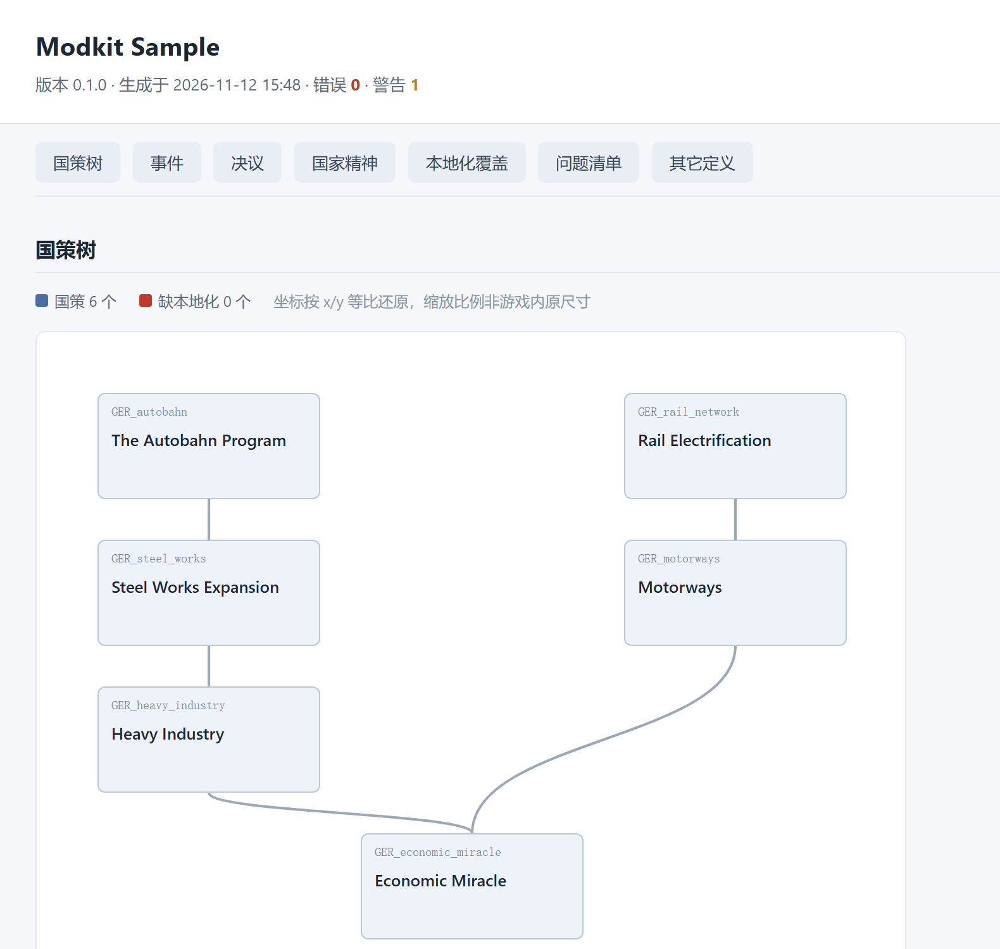

# dsh-hoi4-modding

<p align="center"><a href="README.md">中文</a> ｜ <b>English</b></p>

<p align="center"></p>

<p align="center">
  
</p>

<p align="center"><i>A self-contained HTML generated by <code>kiant_hoi4_preview</code> from <code>examples/sample_mod</code> — no game launch needed to see the real shape of a focus tree, overlapping coordinates, wrong icons, and missing text.</i></p>

A modding toolkit for Hearts of Iron IV. One modding-engineer agent, 15 skills, 20 MCP tools, and a knowledge base that treats the vanilla game as ground truth.

Built for HOI4 1.19.x (Operation Postern). Pure Python standard library, zero dependencies.

> Current version **3.4.0** (2026-11-13). GitHub: [Kiant98/dsh-hoi4-modding](https://github.com/Kiant98/dsh-hoi4-modding) ｜ npm: [dsh-hoi4-modding](https://www.npmjs.com/package/dsh-hoi4-modding)

## What it can do: three real outputs

Every command and output below comes from the `examples/` directory in this repository. Copy-paste runnable (Python 3.9+, no third-party packages).

### 1. Catch defects that fail silently

`examples/broken_mod` is a deliberately broken mod. Run the validator:

```bash
python mcp-server/server.py --call kiant_hoi4_validate_mod '{"mod_path":"examples/broken_mod"}'
```

```json
"summary": { "errors": 6, "warnings": 5, "infos": 6, "total_issues": 17,
             "verdict": "还有硬错误，进游戏会静默失效" }
```

Some of them carry file, line and fix:

```
error  descriptor.mod                              supported_version="1.19.x" is invalid
                                                    → use "1.19.*" or "1.19.4"
error  localisation/english/broken_l_english.yml    missing UTF-8 BOM
                                                    → the whole file is ignored by the engine
error  common/ideologies/broken_ideologies.txt:2    unclosed block: reached end of file
error  common/national_focus/broken_focus_dup.txt:7 focus id 'BAD_focus_a' defined twice
                                                    → first defined in broken_focus.txt:11
error  events/broken_events.txt:4                   event namespace 'BAD' not declared in this file
```

These are exactly the failures that neither crash the game nor reliably reach `error.log` — they are silently dropped.

### 2. Scaffold content

```bash
python mcp-server/server.py --call kiant_hoi4_scaffold \
  '{"mod_path":"./demo","kind":"focus","name":"GER_demo_autobahn","tag":"GER","x":2,"y":2}'
```

```json
"created": ["scaffold_demo/common/national_focus/ger_GER_demo_autobahn.txt",
            "scaffold_demo/localisation/english/ger_GER_demo_autobahn_l_english.yml"],
"next": "跑一遍 kiant_hoi4_validate_mod 确认没有缺本地化或语法错误。"
```

Localisation ships with a BOM; the focus gets real coordinates, prerequisites and completion rewards for 1.19 — not an empty shell.

### 3. Inspect structure without launching the game

```bash
python mcp-server/server.py --call kiant_hoi4_preview '{"mod_path":"examples/sample_mod"}'
```

```json
{ "ok": true, "bytes": 9653,
  "sections": { "focus": true, "events": true, "decisions": true, "ideas": true,
                "coverage": true, "issues": true },
  "summary": { "verdict": "可以进游戏了" } }
```

The artifact, `.modkit/preview.html`, is the screenshot above: overlapping coordinates, missing icons and unwritten text become visible at this stage.

## Why this exists

The Paradox engine has an unpleasant failure mode: it does not crash.

A localisation file without a BOM is ignored entirely, so the UI shows `GER_autobahn` instead of text. An event without `add_namespace` is never registered. A duplicated focus id means one of them is quietly dropped. A misspelled effect skips that line and executes the rest. None of this raises an error, and some of it never reaches `error.log`.

The other half of the problem is the model. The fields of `scripted_gui`, how `archetype` attaches a model, whether an effect was renamed in 1.19 — the answers are not in the prompt, they are in the vanilla files. A model writing from memory produces files whose syntax is flawless and whose field names do not exist.

The toolkit's answer is plain: index the real implementations, look them up before writing, and validate with a machine instead of an eye.

## The loop

```
index vanilla → look up real usage → scaffold → machine validation → offline preview → in-game check
     ↑                                                                                    │
     └─────────────────────── write findings back to the KB ←─────────────────────────────┘
```

## Three rules

### Knowledge comes from proper channels only

The game's own `documentation/*.md` (8600 lines of effects, 7700 lines of triggers) and 31 domain-level `_documentation.md` files are field-level authority, and all of them are indexed. Domains without official docs (focus trees, ideas, technology, equipment, map) use vanilla instance files as authority. Third-party experience is a lead only, graded by trust level — see [references/AUTHORITY.md](references/AUTHORITY.md).

### Every claim has a citation

"This effect exists" comes with `documentation/effects_documentation.md:2343` and the scopes it supports. "This field is misspelled" comes with the file and line. No "generally" and no "the community usually" — those cannot be checked.

### Beginners can start at zero

No need to learn Clausewitz syntax first. Scaffolds run in the game, and the validator speaks human ("line 42 is missing a closing brace; the rest of the file is ignored from there", not `unclosed block@42`). A first-time modder who follows [GETTING-STARTED.md](GETTING-STARTED.md) ends up with a focus of their own.

## What's inside

### 1. Reference library: 163 documents (146 content + 17 indexes)

163 documents under `references/`, 146 of them content and 17 domain indexes. By origin, six groups:

| Origin | Docs | Composition |
|---|---|---|
| Upstream domains | 63 | `00_start` to `06_workflow`, 56 content + 7 domain indexes, unmodified |
| Added domains | 39 | `07_tools` / `08` / `09` / `10` / `93_ecosystem`, 34 content + 5 indexes |
| Case studies | 6 | `90_case-studies`, 5 content + 1 index |
| Error book | 25 | 24 entries + 1 index |
| Solutions | 11 | 10 entries + 1 index |
| Root files | 5 | `_index`, `cheatsheet`, `README`, `ATTRIBUTION`, `AUTHORITY` |

Those six groups add up to 149 (16 indexes + 133 content). A further `99_plugin-devlog/` holds 14 documents
recording the pitfalls of building this plugin itself. It is **not** part of the reference library for modders:
it uses `DEVB-` / `DEVN-` prefixes and separate numbering from `EB-` / `SOL-`, so search never mixes it into mod-related entries.

Covered domains: scripting language, content systems, military, world map, presentation, workflow (with `07_tools` covering tooling rather than a domain).

```
references/_index.md          "I want to do X → read which doc", 50+ routes
references/01_script/         scope / effect / trigger / variables / collections / on_actions
references/03_military/       land, sea, air, equipment, templates, doctrines (these domains are not validated here)
references/04_world/          states, strategic regions, buildings, resources, supply, terrain, map
references/90_case-studies/   real-project field notes (not defaults)
references/91_error-book/     error book: 24 verified pitfalls → standardised fixes
references/92_solutions/      solutions: 10 unverified ideas, marked by status
```

Not all of this is mine. The upstream content comes from the MIT-licensed open-source project `dsh-hoi4-modding`, unmodified; provenance, licence and the entries I re-checked are in [references/ATTRIBUTION.md](references/ATTRIBUTION.md).

Before importing it, I picked several conclusions that would contradict this toolkit's current practice and verified them against real files:

| Upstream claim | Verification |
|---|---|
| `.mod` uses `picture=` not `thumbnail=` | 29 real `.mod` files on this machine: 14 use `picture`, 1 uses `thumbnail` ✅ |
| `common/units/equipment/` exists, `common/equipment/` does not | verified in the game directory ✅ |
| Terrain lives in `common/terrain/00_terrain.txt`, not `map/terrain.txt` | verified ✅ |
| The launch flag is `-debug_mode`, not `-debug` | the launcher's "open game in debug mode" uses `-debug_mode` ✅ |

### 2. Knowledge base: it learns, not just generates

Index vanilla, installed mods and your notes into one SQLite database. Then:

```
kiant_hoi4_kb_lookup kind=tech          → 3 real technology definitions with lines and code
kiant_hoi4_kb_search "scripted_gui"     → locate it across 5000 files
kiant_hoi4_kb_symbol name=GER_pz1_a     → where this id is defined
kiant_hoi4_kb_search "add_to_variable" kind=md   → query the game's field-level docs
```

The game's `documentation/*.md` (`effects_documentation.md`, 8600 lines; `triggers_documentation.md`, 7700 lines) and `common/**/_documentation.md` (31 observed; the reference library's 39 also counts `documentation.md`) are indexed too, and results carry an `authority` tag: `game-doc` > `domain-doc` > `vanilla-instance`, resolved in that order on conflict.

There is one more layer. Every `## name` in `documentation/` becomes a symbol, so "does this effect exist" is one command:

```
kiant_hoi4_kb_symbol name=add_to_variable
→ effect, documentation/effects_documentation.md:2343, Supported Scopes: any
kiant_hoi4_kb_symbol name=add_stabiltiy
→ found: false        ← misspelled
```

Measured: 553 effects and 596 triggers extracted, 544/553 with scopes.

Localisation is indexed for `english` + `simp_chinese` by default. Vanilla ships 10 languages at roughly 130k entries each — 1.3M lines / 350 MB / 9 minutes, and nine tenths of it is never queried. Narrowed to two languages it is 260k entries / 108 MB / 73 seconds. Pass `loc_langs: []` to index everything.

Measured indexing of vanilla 1.19.4.2: 6167 script files, 62k symbols, 260k localisation entries, 16 seconds.

### 3. Validation: twelve pluggable checks

```
kiant_hoi4_validate_mod deep=true
```

| Check | What it does |
|---|---|
| Descriptor | both descriptors, `path` resolution and ASCII, `picture`/`thumbnail`, BOM, duplicate `replace_path`, version format |
| Localisation | BOM, encoding, language header, duplicate keys, missing keys (down to the referencing site) |
| Syntax | bracket balance, token errors, unclosed blocks |
| Duplicate ids | focus/idea/decision/event/technology/character, across files |
| Technology | prerequisites and dependency targets exist, localisation complete |
| Assets | referenced textures and `.mesh` files actually exist |
| Icons | sprites referenced by focus/idea/decision/event resolve |
| Interface | `.gui` syntax, duplicate windows, sprite references |
| Framework | events referenced by `on_actions`, `oob` files, `add_ideas`, `defines` prefixes |
| Music | `play_song`/radio selections defined in `.asset`, audio files present, non-ogg mixed in (EB-022) |
| Focus-tree semantics | broken/cyclic prerequisites, missing or self-referencing exclusivity, overlapping coordinates, broken `relative_position_id` |
| Localisation commands | `[Root.GetXxx]` existence in three tiers: exact match silent, suspected misspelling warn with nearest suggestion, unknown info (CWTools curated table + `scripted_localisation` exemptions) |

Results carry `file`, `line` and `hint`. The hint explains *why* and *how to fix*, not "please check syntax".

Severity is not arbitrary; every finding separates "verified" from "cannot know":

| Level | Meaning |
|---|---|
| `error` | confirmed hard error; the game will silently ignore it |
| `warn` | suspicious, but a legal form may exist |
| `info` | cannot confirm, usually because vanilla/parent mod is not indexed |

A concrete example. A mod references `gfx/leaders/leader_unknown.dds` without shipping it. With vanilla indexed this is verifiable and reported as `error`; without the index the file may well live in vanilla, and hard-reporting an error would falsely accuse every mod that reuses vanilla assets — so it degrades to `info` with the reason. Likewise, a 40%-translated language submod missing 50k keys is a fact, but the parent mod supplies them; when the key count is large and coverage is below 70%, it is treated as a translation submod and reported as a one-line coverage summary.

Those degradation rules were forced by real large mods. The first run produced 70k errors, 99% of them false positives. Converging step by step left two digits on the same files, every one of them clickable and verifiable.

Adding a check is three steps: write a function, add a decorator, done. See [ARCHITECTURE.md](ARCHITECTURE.md#extension-points).

### 4. Preview: see structure without the game

```
kiant_hoi4_preview
```

Generates one self-contained HTML: focus trees drawn at their real x/y coordinates with prerequisite links. Events are not simplified cards — they are assembled from the real geometry in `interface/eventwindow.gui`: the paper frame, the clipboard, the title font, the picture slot and the option buttons' positions and sizes all match the game (if the `.gui` is unreadable it falls back to the built-in vanilla numbers). Decision/idea cards carry parsed text, alongside localisation coverage and the issue list.

With a local game install it goes one step further: sprite names are resolved against vanilla's own `.gfx` files and the DDS textures are decoded and inlined straight into the HTML. A focus pointing at the wrong icon, an event picture that never got wired up, an idea using the wrong series — all visible without launching the game. Textures come from your own installation and are never redistributed; pass `icons=false` to turn it off.

Zero external dependencies, plain HTML, double-click to open. About 14 KB without icons, about 570 KB with icons and event windows (frames are inlined at native size; the images dominate). Overlapping coordinates, wrong icons and unwritten text are visible at this stage.

To see a change the moment you save it, use the watch script:

```bash
python tools/kiant-hoi4-watch.py path/to/your_mod --game --open
```

It starts a small server on `127.0.0.1` and opens a browser tab: `/state` only compares file signatures (cheap), `/render` does the actual rendering, so the page refreshes within a second of a save and costs almost nothing while idle. `--once` renders without starting the server (written to `<mod>/.modkit/preview.html`), `--no-icons` disables textures, `--interval` sets the poll interval and `--port` picks another port.

### 5. Planning: keep long tasks on track

```
kiant_hoi4_plan action=init     → eight stages, each with acceptance criteria
kiant_hoi4_plan action=status   → progress, next step, unmet dependencies
```

It also writes `ROADMAP.md` — plain Markdown checkboxes, git-friendly, readable by collaborators.

## Quick start

### Install

Four routes, same content. Since 3.2.0 the npm package is also a DeepSeek Harness bundle (`dsh.bundle.patch` + `cordis.patch.yml` + `lib/index.js`), so it installs directly from the DSH plugin page:

**Route 1: inside DeepSeek Harness (recommended; since 3.2.0)**

Settings → Plugins → search `dsh-hoi4-modding` → install (click update to the latest version if already installed), then reopen the session. Afterwards:

- 15 skills appear in the skill list and trigger on demand — no manual `SKILL.md` copying;
- 20 tools mount as `mcp__kiant_hoi4_modkit__kiant_hoi4_*`, started through `lib/index.js` with the local `python` running `mcp-server/server.py` (stdio);
- on first load it probes `python`/`python3` (3.9+, zero third-party deps). To pin an interpreter set the plugin config to `{"python": "C:/path/to/python.exe"}`; to skip tools set `{"mcp": false}`.

```bash
# Route 2: git clone
git clone https://github.com/Kiant98/dsh-hoi4-modding.git dsh-hoi4-modding
cd dsh-hoi4-modding

# Route 3: download the release asset dsh-hoi4-modding-3.4.0.zip
unzip dsh-hoi4-modding-3.4.0.zip -d dsh-hoi4-modding
cd dsh-hoi4-modding

# Route 4: from npm (since 3.1.0)
npm install dsh-hoi4-modding        # into ./node_modules
npm pack dsh-hoi4-modding           # or fetch the tarball and unpack it yourself
```

After a global install (`npm i -g dsh-hoi4-modding`) the toolkit lives in the global `node_modules/dsh-hoi4-modding/` (on Windows usually `%APPDATA%\npm\node_modules`); every `mcp-server/server.py` path below refers to that directory. Using it outside DSH (running the MCP server manually, wiring another client) is unaffected.

Confirm it runs:

```bash
python mcp-server/server.py --list                            # list the 20 tools
python mcp-server/server.py --call kiant_hoi4_kb_stats '{}'   # knowledge-base status
```

Build the index (about 30 seconds the first time, incremental afterwards):

```bash
python mcp-server/server.py --call kiant_hoi4_kb_build '{"action":"discover"}'   # what can be indexed
python mcp-server/server.py --call kiant_hoi4_kb_build '{"action":"build"}'      # build it
```

Client-specific wiring is in [platform/README.md](platform/README.md).

## Knowledge: platform first, local fallback

Knowledge has two tiers; search queries the platform tier first.

| Tier | Content | Maintained by | When it is built |
|---|---|---|---|
| Platform library | Author-published knowledge (field notes, pitfalls, version differences) | the author, published to an open platform periodically | `kiant_hoi4_kb_sync action=pull` |
| Local library | vanilla index, bundled reference library, your notes, explicitly named local dirs | you | `kiant_hoi4_kb_build` (vanilla + reference library by default) |

```bash
# pull the platform library
kiant_hoi4_kb_sync action=pull

# build the local library (vanilla + reference library, 20 seconds)
kiant_hoi4_kb_build action=build

# to index one of your folders, name it explicitly — the tool never scans on its own
kiant_hoi4_kb_build action=build local_dirs=["D:/my-notes","D:/old-mod-docs"]
```

### Search tiers

The `scope` argument of `kiant_hoi4_kb_search` selects the tier:

| scope | Behaviour |
|---|---|
| `auto` (default) | query the platform tier first; on a hit return it and note "local not searched"; only on a miss fall back to local and say "these come from local" |
| `platform` | platform only. Use it when you want to know what the author actually says |
| `local` | local only. Use it for your own notes and vanilla instances |
| `all` | both, platform results first |

Responses carry `answered_from`, `tiers` (hit counts per tier) and `message` (why this tier answered) — you never have to guess where data came from.

### How the platform library syncs

Fill `knowledge/remote.json` once:

```json
{ "repo": "user/repo", "branch": "main", "paths": ["knowledge/notes", "references"] }
```

Then three commands:

```
kiant_hoi4_kb_sync action=status   → local 2026.11.06 / remote 2026.11.06-2 / stale true
kiant_hoi4_kb_sync action=pull     → download about 1 MB, cached in ~/.kiant-hoi4-modkit/remote/
kiant_hoi4_kb_build action=build   → a remote source appears and search hits it
```

`pull` is idempotent and returns `skipped: true` when versions match. Offline it leaves the cache untouched, keeps searching stale data and states which version answered.

### Author side

Repository layout, `manifest.json` format, publishing flow and checklist are in [PUBLISHING-KB.md](PUBLISHING-KB.md).

The flow itself is light: edit the knowledge, bump `manifest.json`'s `version`, push. The plugin builds no artifacts.

Keeping the local and WorkBuddy libraries consistent (local-first, same format, archived old versions, two-way verification) is covered by [PUBLISHING-LIBRARY.md](PUBLISHING-LIBRARY.md).

### Why SQLite is not shipped

| Reason | Detail |
|---|---|
| Size | 131 MB, one or two orders of magnitude larger than the plugin |
| Machine-bound | it stores the author's game paths, line numbers and mod list |
| A derivative | it is indexed from the game installation and rebuilds on another machine |

The remote repository carries knowledge only (Markdown, about 1 MB), never the game index.

### It works without an index — and says what is missing

Validation results contain a `summary.index` block:

```json
{
  "vanilla_indexed": false,
  "kb_loaded": false,
  "degraded": ["assets", "sprites", "technology", "history"],
  "hint": "尚未建索引：这四类检查只做到「文件存在」…跑一次 kiant_hoi4_kb_build action=build 即可"
}
```

The block exists for a reason. Without it a newcomer reads "0 errors" and assumes everything was checked, while four classes of checks were fully degraded. That is exactly the silent failure this plugin criticises — it must not commit it itself.

### The first index collects three sources

```bash
python mcp-server/server.py --call kiant_hoi4_kb_build '{"action":"build"}'
```

```
vanilla   the game: 6167 files          ← first-hand facts, the reference for every check
refs      reference library: 163 docs (63 upstream + 39 added + 6 cases + 25 error book + 11 solutions + 5 root + 14 devlog)
                                        ← ships with the plugin, works out of the box
notes     your local notes
```

Third-party mods are excluded by default. With 40 workshop mods installed, indexing them all turns a 20-second build into tens of minutes, and half-finished or translation-only packs pollute search results. Name them explicitly when needed:

```bash
... '{"action":"build","include_mods":true}'      # all of them
... '{"action":"build","only":"mod:my-mod"}'      # one of them
```

`action=discover` lists every discoverable mod and marks it `opt_in: true`.

## Self-test and stress test

After changing a core module, run this instead of clicking tools by hand:

```bash
python mcp-server/selftest.py                 # 368 assertions in seventeen groups: parser / validation / planning / preview / scaffolding / KB / protocol / remote / two tiers / error book / status / doc consistency / standalone tools / real localisation / conditional blocks / vanilla tolerance
python mcp-server/bench.py <mod path>         # timings on a real mod, plus false positives
```

`selftest.py` ships `examples/broken_mod/`: a deliberately broken mod with 18 classic defects injected (missing BOM, missing brace, duplicated id, event without namespace, missing texture, version written as `1.19.x`, …). The self-test asserts that 14 of them are caught by the matching checks, with the right severity. To confirm a check is really working, look there.

### A complete turn

```
User: add an industrial focus line to GER, six focuses, then show me the result

agent → kiant_hoi4_kb_lookup kind=focus            inspect vanilla focus-tree structure
      → kiant_hoi4_scaffold kind=focus             build the first one, localisation included
      → write the other five, wire coordinates and prerequisites
      → kiant_hoi4_validate_mod deep=true          0 errors
      → kiant_hoi4_preview                         generate HTML; focuses 3 and 4 overlap
      → fix coordinates, re-validate
      → report: files changed, tree shape, what is left undone
```

## Tools

| Tool | Purpose |
|---|---|
| `kiant_hoi4_self_check` | sanity-check the validators themselves: run vanilla as a mod. After changing validation logic, run it first — thousands of errors on vanilla can only mean the validator is wrong |
| `kiant_hoi4_validate_mod` | structural check; `deep=true` enables every validator; `per_check`/`max_issues` bound detail |
| `kiant_hoi4_scaffold` | 12 content scaffolds, with BOM localisation |
| `kiant_hoi4_scan_localisation` | localisation-only scan |
| `kiant_hoi4_fix_localisation` | add BOM, GBK→UTF-8 |
| `kiant_hoi4_find_duplicate_ids` | duplicate definitions |
| `kiant_hoi4_parse_script` | Clausewitz → JSON, with drill-down |
| `kiant_hoi4_analyze_error_log` | cluster and classify the log |
| `kiant_hoi4_error_book` | symptom lookup in the error book (24 verified pitfalls) |
| `kiant_hoi4_solutions` | solutions library (10 entries, marked by verification status) |
| `kiant_hoi4_list_overrides` | override comparison |
| `kiant_hoi4_kb_build` | build/update the index |
| `kiant_hoi4_kb_search` | full-text search |
| `kiant_hoi4_kb_lookup` | fetch real examples |
| `kiant_hoi4_kb_symbol` | trace symbol definitions |
| `kiant_hoi4_kb_note` | add local notes |
| `kiant_hoi4_kb_sync` | sync from the remote repository |
| `kiant_hoi4_kb_stats` | index status |
| `kiant_hoi4_preview` | offline HTML preview (can inline local game icons) |
| `kiant_hoi4_plan` | staged planning |

## Skills (15)

`mod-skeleton` · `clausewitz-script` · `localisation` · `focus-tree` · `events-decisions` · `technology` · `models-3d` · `ui-interface` · `game-framework` · `gfx-interface` · `debug-validate` · `compat-release` · `knowledge-base` · `planning` · `validator-trust`

The DSH bundle registers all 15 automatically — no manual copying. They trigger on demand and describe *where things break* and *how to tell*, not tutorials.

## Community and contributing

- **Bugs / issues**: [GitHub Issues](https://github.com/Kiant98/dsh-hoi4-modding/issues)
- **Discussion**: [GitHub Discussions](https://github.com/Kiant98/dsh-hoi4-modding/discussions) — concrete modding problems, pitfall sharing, domains worth adding
- **Contributing**: [CONTRIBUTING.md](CONTRIBUTING.md) — how to add an error-book entry, a reference doc or a validator, and the self-test gate
- **Changelog**: [CHANGELOG.md](CHANGELOG.md)
- **Marketplace entry**: [awesome-dsh-plugin](https://github.com/awesome-dsh-plugin/awesome-dsh-plugin) (category: skill)
- **Upstream provenance and licence**: [references/ATTRIBUTION.md](references/ATTRIBUTION.md)

## Directory

Every file and folder is explained in [STRUCTURE.md](STRUCTURE.md): one page with a layer diagram, per-file notes, and "where to edit when you want to change X". The tree alone:

```
dsh-hoi4-modding/
├── plugin.json              cross-platform capability manifest (single source of truth for version/skills/tools/resources)
├── cordis.patch.yml         DSH bundle patch: mounts this package as a plugin row
├── lib/index.js             DSH entry: registers 15 skills + mounts the MCP server
├── icon.svg                 plugin icon
├── README.md                this file (Chinese)
├── README.en.md             English edition, kept in sync
├── CONTRIBUTING.md          contribution guide (bilingual)
├── STRUCTURE.md             organisation: what each layer and file is for + where to edit
├── ARCHITECTURE.md          five-layer architecture, data flow, extension points
├── GETTING-STARTED.md       a first focus tree from zero
├── PUBLISHING-KB.md         author side: publishing the knowledge base
├── PUBLISHING-LIBRARY.md    author side: keeping local and platform libraries consistent
├── agents/kiant-hoi4-modder.md    full-lifecycle agent definition
├── skills/                  15 skills, one folder each
├── mcp-server/              zero-dependency Python, 14 modules
│   ├── server.py            20 tools + MCP protocol
│   ├── checks.py            structural validation
│   ├── kb.py                index and two-tier search
│   ├── cw.py                Clausewitz parser (foundation)
│   ├── validators.py        10 pluggable type validators
│   ├── playbook.py          error book and solutions lookup
│   ├── preview.py           offline preview renderer (focus tree / event window / cards)
│   ├── gui.py               read-only .gui: control geometry for the event window
│   ├── assets.py            texture pipeline: DDS/TGA → inline PNG
│   ├── scaffolder.py        12 content scaffolds
│   ├── remote.py            remote KB sync
│   ├── planner.py           staged planning
│   ├── selftest.py          368 self-tests
│   └── bench.py             stress test on real mods
├── references/              163 docs in 16 folders (upstream MIT + authored + built)
│   ├── _index.md            master routing: "I want X → read which doc"
│   ├── 00_start … 06_workflow      seven knowledge domains, 63 upstream docs
│   ├── 07_tools             upstream CLI usage ⚠ not available here, see EB-018
│   ├── 90_case-studies      real-project notes (not standards)
│   ├── 91_error-book        24 verified pitfalls → standardised fixes
│   ├── 92_solutions         10 unverified ideas (marked by status)
│   └── README / AUTHORITY / ATTRIBUTION / cheatsheet
├── knowledge/
│   ├── notes/               your notes, indexed
│   ├── sources.example.json sample pinned index sources: copy to sources.json and edit
│   ├── sources.json         effective index sources (machine paths, gitignored)
│   └── remote.json          remote library repository config
├── platform/                client wiring (pasted by hand, nothing auto-loaded)
└── examples/
    ├── sample_mod/          runnable positive case: 0 errors, self-test baseline
    └── broken_mod/          deliberately broken negative case: 18 defects, 14 asserted
```

## Boundaries

### Which tools read, which write

13 of the 20 tools are read-only. The ones that write say where:

| Tool | Writes | Where |
|---|---|---|
| `kiant_hoi4_self_check` | — | read-only (changes nothing) |
| `kiant_hoi4_validate_mod` | — | read-only |
| `kiant_hoi4_scan_localisation` | — | read-only |
| `kiant_hoi4_find_duplicate_ids` | — | read-only |
| `kiant_hoi4_parse_script` | — | read-only |
| `kiant_hoi4_analyze_error_log` | — | read-only |
| `kiant_hoi4_list_overrides` | — | read-only |
| `kiant_hoi4_kb_search` / `lookup` / `symbol` / `stats` | — | read-only |
| `kiant_hoi4_error_book` / `solutions` | — | read-only, reads the md files each time, no index needed |
| `kiant_hoi4_kb_build` | ✅ | `~/.kiant-hoi4-modkit/kb.sqlite` (neither game nor mod directory). `action=discover` is read-only |
| `kiant_hoi4_kb_sync` | ✅ | `~/.kiant-hoi4-modkit/remote/` (remote knowledge cache). `action=status` is read-only; only pull goes online |
| `kiant_hoi4_kb_note` | ✅ | same database, notes only |
| `kiant_hoi4_preview` | ✅ | `<mod>/.modkit/preview.html` by default. Pass `out_path` to write elsewhere |
| `kiant_hoi4_plan` | ✅ | `<mod>/.modkit/plan.json` + `<mod>/ROADMAP.md` |
| `kiant_hoi4_scaffold` | ✅ | new content files under `<mod>/` |
| `kiant_hoi4_fix_localisation` | ✅ | rewrites encoding/BOM of `<mod>/localisation/*.yml`. `dry_run=true` by default |

`.modkit/` is the tools' metadata directory; HOI4 never loads it (the engine reads a whitelist of directories). If you want the mod folder pristine, point preview `out_path` elsewhere and skip planning there.

The game installation is always read-only: not one line writes `<GAME_DIR>`.

### Other boundaries

No game execution. Every check is static; balance, AI behaviour and feel must be tested in game.

No 3D models. `.mesh` is binary and needs Blender plus the Paradox exporter; this toolkit only validates reference paths.

No network access. Tools read local files only. Looking things up on the wiki/GitHub is the agent's job, and findings can be written back into the local KB.

Nothing runs automatically. No preloaded MCP configs, hooks or install scripts. Wiring requires pasting config by hand — those few lines are worth reading yourself.

Version-bound to 1.19. If 1.20 renames an effect the validator will not know, but log analysis still catches `invalid`; the reference library's `06_workflow/migration.md` has an upgrade checklist.

Effect/trigger names are queryable but not auto-reported. The name table is extracted from `documentation/` (553 + 596), and `kiant_hoi4_kb_symbol name=xxx` confirms existence and scopes in one command. It is not an automatic scan because deciding whether a key is an effect call or a structural field needs a complete semantic table; guessing wrong floods tens of thousands of false positives. Better to let the agent ask.

Military, map and fonts get shallow checks only. Validators can tell whether a referenced file exists, not whether the fields are right. Field lists for those domains live in `references/03_military`, `04_world` and `05_presentation`.

## Status

The framework is complete and has run on real data:

| Object | Size | Index | Validation | Result |
|---|---|---|---|---|
| `examples/sample_mod` | 10 files | — | 0.1 s | 0 errors |
| `examples/broken_mod` | 12 files | — | 0.1 s | 18 injected defects, all 14 assertions hit |
| vanilla 1.19.4.2 | 6167 files / 260k entries / 50 official docs | 16 s | — | 553 effects + 596 triggers queryable |

368 self-tests green, covering the parser, example mods, failure fixtures (12 defect assertions all hit), planner, preview (including focus-coordinate resolution), scaffolding, KB, MCP protocol handshake, remote sync, two-tier library, error book and solutions lookup, platform status hints, structure-document consistency, standalone tools (DDS header and block rounding, lint's three error classes and false-positive boundary), conditional blocks, and tolerance of real vanilla writing.

## How far can you trust the validator

How much of what the tool reports can you believe? There is a measured answer.

Run vanilla (known-good) through the validators as if it were a mod and count the false accusations. On 1.19.4.2 it is 1838 errors, the vast majority real localisation gaps in vanilla (1000+ ideas sit in `hidden_ideas` and are never shown).

That number is itself the conclusion: **the validator's strictness ceiling is the engine's strictness; anything above it is a false positive.** Ten thousand errors get read by nobody, which is the same as no check at all.

So when facing a wall of red, triage in this order:

| Situation | Judgement | Action |
|---|---|---|
| Vanilla writes it the same way | likely false positive | ignore for now, but record it |
| Only your file triggers it | real problem | fix per the report |
| Cannot tell | check the error book | `EB-016` lists false-positive types in a comparison table |

`kiant_hoi4_self_check` runs vanilla as a mod in one command and reports per class whether it looks like a false positive. To confirm by hand:

```python
import checks, kb
van = kb.find_game_dir()
r = checks.validate_mod(van, per_check=100000, max_issues=100000)
print(r["summary"]["breakdown"])
```

The criterion is one-directional: many errors on vanilla mean systematic false positives; zero errors only means no systematic false positives, **not that everything is caught**.

How the tool was fixed and how many errors each version shed is recorded in `references/99_plugin-devlog/` — for whoever maintains the plugin, not for its users.

## License

MIT. Text, agent and code may be modified, used commercially and redistributed closed-source, as long as the copyright notice is kept.

Hearts of Iron IV is a trademark of Paradox Interactive AB. This is an unofficial community tool, unaffiliated with Paradox.
